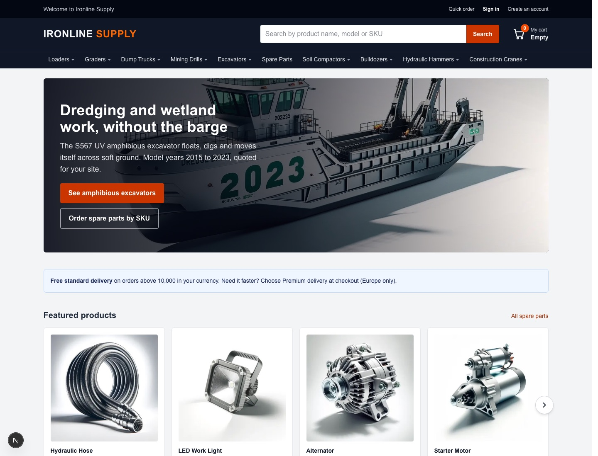
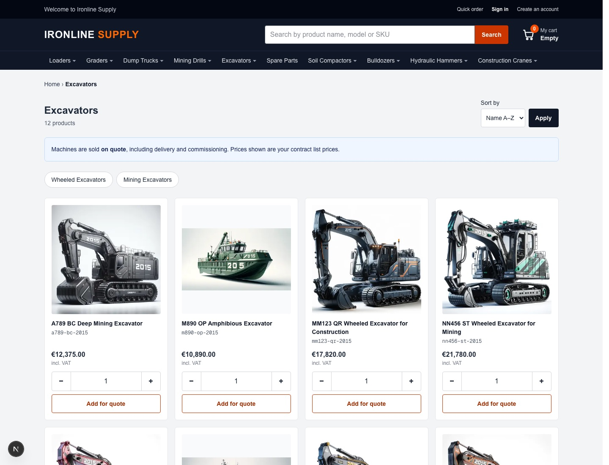
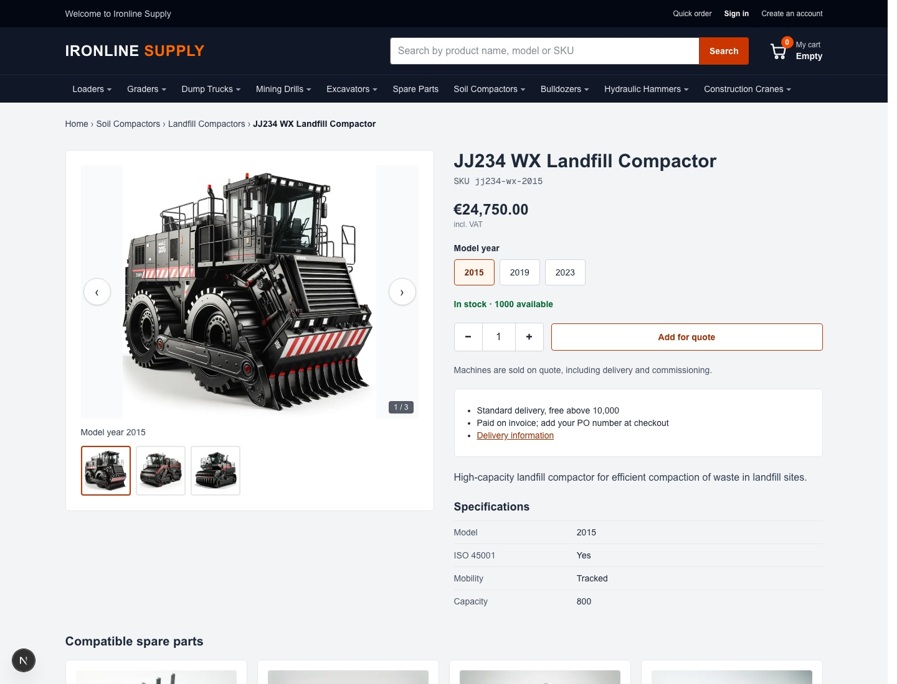
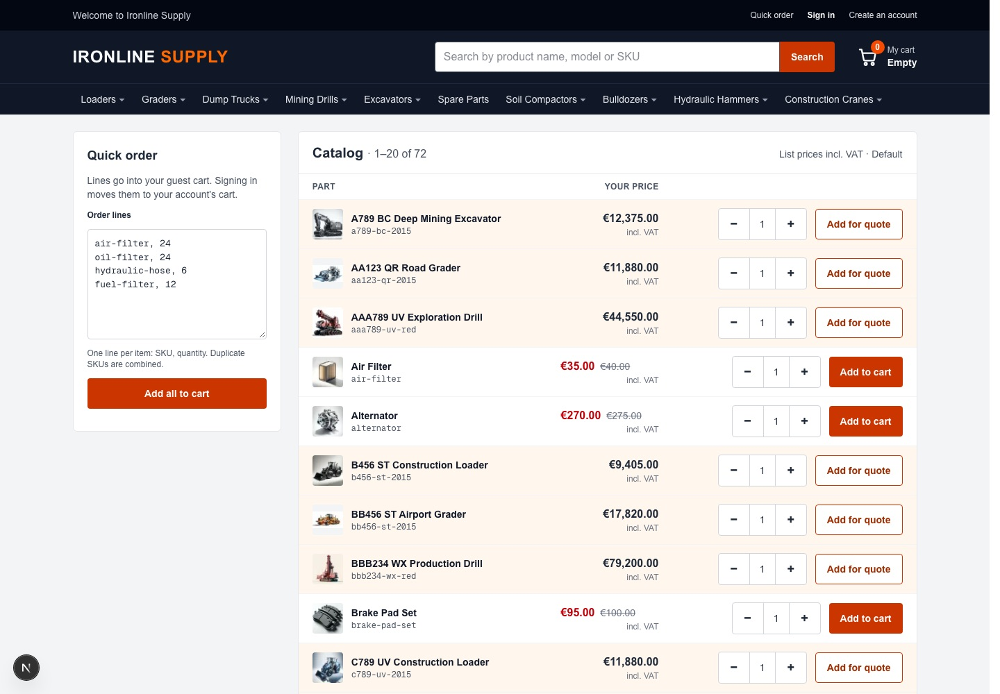
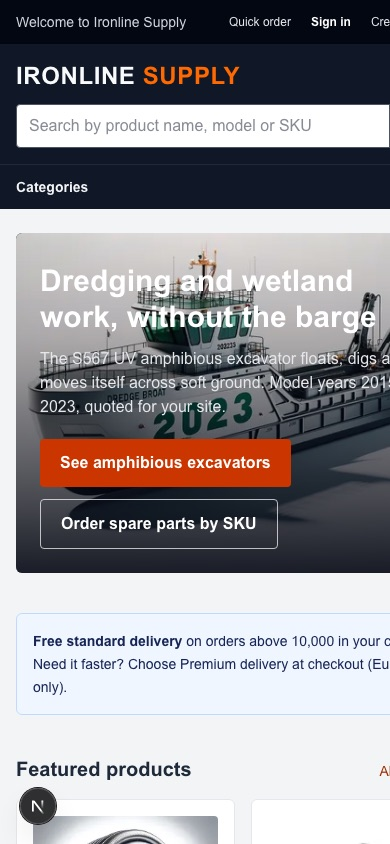

# Forgeline

**An open-source B2B and B2C storefront for commercetools, built with Next.js 15.**

Forgeline is a complete, working online shop on top of [commercetools Composable Commerce](https://commercetools.com/). One storefront serves three kinds of customers: business buyers, consumers and guests. It brings the B2B features merchants know from Magento (Adobe Commerce) B2B: company accounts, quick order, quotes, approval rules and requisition lists. You can see and adapt everything, without a paid frontend platform.

The demo shop, **Ironline Supply**, sells heavy machines and spare parts using the commercetools B2B sample data: 72 products, 6 business units and 5 stores.

   



---

## Contents

- [Who it is for](#who-it-is-for)
- [What your customers can do](#what-your-customers-can-do)
- [What you manage as a merchant](#what-you-manage-as-a-merchant)
- [Screenshots](#screenshots)
- [How it works](#how-it-works)
- [Quick start](#quick-start)
- [Configuration](#configuration)
- [Commands](#commands)
- [Project structure](#project-structure)
- [Roadmap](#roadmap)
- [FAQ](#faq)

## Who it is for

- **Merchants** who are moving from Magento or another all-in-one platform to commercetools, and want to see what a B2B shop on commercetools looks like before they build one.
- **Agencies and developers** who need a reference build: real code for business units, associate roles, standalone prices, quotes and approval flows, not just API examples.
- **Teams learning commercetools**: every feature is mapped to the commercetools API it uses, and the gotchas we hit are written down.

## What your customers can do

### Business buyers (B2B)

| Feature | What it means in practice |
|---|---|
| **Company accounts** | Buyers sign in as associates of a business unit (company or division) and switch between the units they belong to. |
| **Company-specific prices** | Each unit buys from its own store and channel, so it sees its own price list and currency (for example EUR for Spain, USD for the US). |
| **Quick order** | Paste a list of SKUs and quantities, or pick from a searchable catalog table. Unknown SKUs are reported, not silently dropped. |
| **Purchase lists** | Like Magento requisition lists: save products you reorder, then add one line, a selection or the whole list to the cart in one click. |
| **Request a quote** | Machines above a set value go into the cart "for quote". Buyers request a quote, negotiate, and order from the accepted quote. |
| **Approval rules** | Orders above a threshold wait for an approver in the company. Approvers approve or reject with a reason, and the buyer is notified. |
| **Order on invoice** | Business checkout with a purchase order (PO) number. |
| **Company area** | Admins see the company profile, users, roles and permissions, company structure, approval rules and company-wide orders. What each person sees follows their role. |

### Consumers and guests (B2C)

- Browse the catalog, search with autocomplete and typo tolerance, and fill a cart without an account.
- Sign up, verify email, reset a forgotten password, and keep an address book.
- Check out as a guest or a consumer on a one-page, Magento-style checkout: shipping address, shipping method, payment.
- When a guest signs in, their cart is merged into their account cart and re-priced.

### Everyone

- Fast catalog pages: guest pages are cached and refreshed automatically when products or content change.
- Product pages with an image gallery, variants (for example model year), live stock, specifications, compatible spare parts and related products.
- My account: dashboard, orders, quotes, purchase lists, addresses and account information.

## What you manage as a merchant

Everything runs on commercetools. There is no second admin to learn.

| You want to change... | Where |
|---|---|
| Products, prices, stock, categories | **Merchant Center** (catalog, standalone prices, inventory). Changes show up on the storefront automatically. |
| Companies, buyers and their roles | **Merchant Center → Customers → Business units** and **Associate roles**. |
| Homepage banners, info blocks, featured products, static pages (delivery, terms, about) | The **Content** app inside Merchant Center (included in `cms-app/`), with image uploads and a Markdown editor. Content can be scheduled with start and end dates. |
| Quotes | Merchant Center **Quotes**: answer requests, set prices and validity. |
| Orders and approvals | Merchant Center **Orders**. Approval rules can also be managed by company admins in the storefront. |

The Content app runs on **commercetools Connect** (see `connect.yaml`), so you don't need extra hosting for it.

## Screenshots

| Category page | Product page |
|---|---|
|  |  |

| Quick order | Mobile |
|---|---|
|  |  |

## How it works

```
Browser ──> Next.js 15 (App Router, Server Components, Server Actions)
              │
              ├─ admin API client (server only) ──> catalog, prices, business units, content
              └─ customer token (per sign-in, narrowed scopes) ──> my carts, orders, quotes, lists
                                     │
                                     v
                     commercetools Composable Commerce
                     (stores, channels, standalone prices, business units,
                      associate roles, quotes, approval flows, shopping lists)
```

Key design choices:

- **Server-first.** Pages are React Server Components. Every change (add to cart, place order, approve) is a Server Action. No commercetools credentials ever reach the browser.
- **Least privilege.** Each signed-in customer gets their own commercetools token, limited to "my" resources in the stores they buy from. The admin client is only used after a live permission check.
- **Standalone prices.** Prices are selected per store, channel, currency and country, so each company sees its own prices.
- **SEO built in.** Metadata and canonical URLs per page, Product and Breadcrumb structured data (JSON-LD), sitemap, robots.txt, and `next/image`. Company prices never appear in markup.
- **No lock-in.** Plain Next.js, the official commercetools TypeScript SDK and Tailwind CSS. No paid frontend platform.

## Quick start

**You need:** Node.js 22 (the Content app pins it in `cms-app/.nvmrc`) and a commercetools project (a free trial works). Load the **B2B sample data** for the demo.

1. **Clone and install**

   ```bash
   git clone https://github.com/sohelrana09/forgeline-storefront.git
   cd forgeline-storefront
   npm install
   ```

2. **Create two API clients** in Merchant Center → Settings → Developer settings:
   - an **admin** client (template "Admin client"), used on the server only;
   - a **storefront** client for customer sign-in, with these scopes *for every store you sell from*: `manage_my_profile`, `manage_my_orders`, `manage_my_quote_requests`, `manage_my_quotes`, `manage_my_shopping_lists`, `create_anonymous_token`.

3. **Configure**

   ```bash
   cp .env.example .env
   ```

   Fill in both clients, your project key and your region URLs. See [Configuration](#configuration).

4. **Check the connection and seed demo data**

   ```bash
   npm run ct:hello
   ```

   ```bash
   npm run ct:content
   ```

   To sign in as the sample buyers, create a git-ignored `.env.demo` file with `DEMO_BUYER_PASSWORD=<a password of your choice>`, then run `npm run ct:seed-buyers`. Optionally run `npm run ct:seed-associates` and `npm run ct:seed-approval-rules` too.

5. **Run**

   ```bash
   npm run dev
   ```

   Open http://localhost:3000. Browse as a guest, or sign in as a sample buyer such as `sofia-lopez@ltsl.com`.

## Configuration

All settings live in `.env` (never commit it). `.env.example` documents every variable.

| Variable | Purpose |
|---|---|
| `CTP_PROJECT_KEY`, `CTP_CLIENT_ID`, `CTP_CLIENT_SECRET`, `CTP_SCOPES` | Admin API client (server only). |
| `CTP_AUTH_URL`, `CTP_API_URL` | Your region, for example `https://auth.us-east-2.aws.commercetools.com`. |
| `CTP_STOREFRONT_CLIENT_ID`, `CTP_STOREFRONT_CLIENT_SECRET` | Client for customer sign-in (password flow). |
| `SITE_URL` | Public address of the shop. Needed for production builds, email links, canonicals and the sitemap. |
| `SITE_INDEXABLE` | `true` lets search engines index the catalog. Anything else (the default) keeps the whole site out of Google and Bing: `noindex` on every response and an empty sitemap. |
| `UPSTASH_REDIS_REST_URL`, `UPSTASH_REDIS_REST_TOKEN` | Optional. Shares the rate limits (sign-in, sign-up, checkout) across all server instances. On Vercel, connect Upstash under Storage and they are set for you. |
| `REVALIDATE_SECRET` | Lets content and catalog updates refresh cached guest pages (`POST /api/revalidate`). |
| `B2C_CARD_PAYMENTS`, `CTP_CHECKOUT_APPLICATION_KEY` | Card payments through commercetools Checkout (a Payment Only application in Merchant Center). Off by default: consumers pay by bank transfer. |

**Hosting region:** keep the storefront next to your commercetools region, because every page talks to the API. `vercel.json` pins Vercel functions to `cle1` (Cleveland), beside commercetools' AWS us-east-2. If your project is in another region, change it, for example to `fra1` for europe-west1. From far away, each API call adds a few hundred milliseconds.

Store prices: the sample stores have no countries set, so the mapping from store to currency and country is in `STORE_PRICING` in `src/features/business-units/service.ts`. Adjust it for your own stores.

## Commands

| Command | What it does |
|---|---|
| `npm run dev` | Development server on port 3000. |
| `npm run build` / `npm start` | Production build (also type-checks) and server. |
| `npm run typecheck` / `npm run lint` | Quality gates. |
| `npm run ct:hello` | Smoke test: credentials, project, first products and business units. |
| `npm run ct:contexts` | Prints each business unit's store, channel and currency. |
| `npm run -s ct:query -- <path> [where] [limit]` | Read-only API query, handy with `jq`. |
| `npm run ct:content` | Publishes `content/blocks` and `content/pages` to commercetools. |
| `npm run ct:media-library` | Image library for content on the commercetools CDN. |
| `npm run ct:seed-buyers` / `ct:seed-associates` | Demo passwords for the sample buyers, admins and approvers. |
| `npm run ct:seed-approval-rules` | Demo approval rule: orders over €10,000 need approval. |
| `npm run ct:quote-respond -- <requestId> --discount 10` | Acts as the seller and publishes a quote, for testing. |
| `npm run ct:create-bu -- <key> <email>` | Creates a company business unit with a buyer. |
| `npm run ct:connect-content-app` | Deploys the Content app on commercetools Connect. |
| `npm run ct:catalog-subscription` | Catalog changes trigger a cache refresh. |

All scripts are idempotent, so running them twice changes nothing the second time.

## Project structure

```
src/app/           routes only (thin pages): (shop), (auth), (checkout), (cached) guest pages
src/features/<x>/  one folder per business area: catalog, cart, checkout, orders, quotes,
                   approvals, purchase-lists, company, account, auth, cms, quick-order, ...
    components/    the feature's UI
    actions.ts     Server Actions (public entry points)
    service.ts     commercetools calls and business logic
src/components/    shared UI: header, footer, buttons, list toolbars
src/lib/           infrastructure: commercetools clients, caching, rate limits, mailer
cms-app/           the Merchant Center "Content" custom application
content/           content as JSON (blocks and pages), published with ct:content
scripts/           setup, seed and maintenance scripts
docs/images/       screenshots
```

## Roadmap

Done: company switcher, customer sign-in, quick order, storefront pages, content management, quotes, guest cart, My account, company area, B2C accounts, SEO, cached guest pages, image gallery, one-page checkout, search autocomplete, homepage banners, purchase lists, approval rules.

Next:
- Company-shared purchase lists.
- Card payments switched on by default.
- ERP connector (order export, stock and price import).

Ideas and pull requests are welcome: open an issue first for larger changes.

## FAQ

**Is this an official commercetools product?**
No. Forgeline is an independent open-source project. commercetools is a trademark of commercetools GmbH.

**Do I need commercetools Frontend (the paid frontend platform)?**
No. Forgeline is plain Next.js and can be hosted anywhere Next.js runs, for example Vercel, Netlify, AWS or your own Node server.

**Can I use my own catalog instead of the sample data?**
Yes. The storefront reads whatever is in your project. Check `STORE_PRICING` for your stores, and the category menu follows your Merchant Center category tree.

**Is it production-ready?**
It is a reference build with security in mind (narrowed customer tokens, server-only credentials, rate limits, encrypted session cookies). Review it against your own requirements, add payment and email providers, and run your own tests before going live.

---

Made with Next.js and commercetools. If Forgeline helps you, please give it a star.
